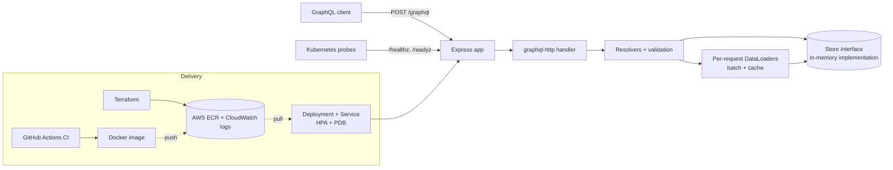

# Cloud-Native GraphQL Service

[](https://github.com/prernareddym/cloud-native-graphql-service/actions/workflows/ci.yml)


A small **GraphQL API** (a reading-list "bookshelf") written in TypeScript with Node.js and Express, packaged with **Docker**, deployable with **Kubernetes** manifests, with **Terraform** for the AWS container registry, and checked by a **GitHub Actions** pipeline.

> **Personal portfolio / learning project.** I built it to practice GraphQL API design and the packaging and infrastructure-as-code around a service. It is not a production system, has no real users, and is not related to any employer's work. Data is held in memory and resets on restart. The Terraform has been validated but never applied to a real AWS account, and the Kubernetes manifests have been schema-checked but not deployed to a cluster.

## What it demonstrates

- **GraphQL schema design**: enums, input types, nested types (`Book.author`, `Author.books`), filtering and offset paging, aggregate stats
- **DataLoader batching**: author lookups for a list of books collapse into one store call (a test asserts this), per-request loaders so nothing leaks between requests
- **Input validation with typed errors**: `BAD_USER_INPUT` and `NOT_FOUND` error codes
- **Operational basics**: liveness/readiness endpoints, structured JSON logs, graceful shutdown on `SIGTERM`
- **Deployment artifacts**: multi-stage non-root Docker image, Kubernetes Deployment/Service/HPA/PodDisruptionBudget, Terraform for ECR and CloudWatch
- **CI**: lint, type-check, tests with coverage, build, Docker image build, `terraform fmt/validate`, Kubernetes manifest validation

## Tech stack

Node.js 20 · TypeScript (strict) · Express · graphql-js · graphql-http · DataLoader · Jest · supertest · ESLint · Docker · Kubernetes · Terraform (AWS provider) · GitHub Actions

## Architecture



## Quick start

```bash
npm install
npm run dev                          # http://localhost:4000/graphql with sample data
```

or with Docker:

```bash
docker compose up --build
```

Try a query:

```bash
curl -s localhost:4000/graphql -H 'Content-Type: application/json' -d '{
  "query": "{ books(status: FINISHED) { total items { title rating author { name } } } stats { total averageRating } }"
}'
```

And a mutation:

```graphql
mutation {
  addAuthor(name: "Ursula K. Le Guin") { id }
}
# then
mutation {
  addBook(input: { title: "A Wizard of Earthsea", authorId: "4", tags: ["fantasy"] }) {
    id title status author { name }
  }
}
```

### Schema at a glance

```graphql
type Query {
  book(id: ID!): Book
  books(status: ReadingStatus, search: String, limit: Int = 10, offset: Int = 0): BookPage!
  authors: [Author!]!
  stats: ShelfStats!
}
type Mutation {
  addAuthor(name: String!): Author!
  addBook(input: AddBookInput!): Book!
  updateBook(id: ID!, input: UpdateBookInput!): Book!
  deleteBook(id: ID!): Boolean!
}
```

Full SDL: [`src/schema.ts`](src/schema.ts).

### Configuration

| Variable | Default | Notes |
| --- | --- | --- |
| `PORT` | `4000` | |
| `SEED_SAMPLE_DATA` | `true` | Set to `false` for an empty store |

## Tests

```bash
npm test            # or: npm run test:ci   (with coverage)
npm run lint && npm run typecheck
```

19 tests across 2 suites (about 96% statement coverage): queries with nested fields, filters, search and paging, argument validation, `averageRating` edge cases, mutation validation and cleanup (trimmed titles, de-duplicated lower-cased tags), partial updates, clearing a rating with `null`, delete semantics, DataLoader batching, health probes and malformed requests.

## Deployment artifacts

### Terraform (`deploy/terraform`)

Creates an **ECR repository** (immutable tags, scan on push, lifecycle policy keeping the newest N images) and a **CloudWatch log group**.

```bash
cd deploy/terraform
terraform init
terraform plan            # needs AWS credentials; review before applying
```

Without credentials you can still run `terraform init -backend=false && terraform validate`, which is what CI does.

### Kubernetes (`deploy/k8s`)

Deployment (2 replicas, rolling update, readiness/liveness probes, resource requests/limits, non-root, read-only root filesystem, dropped capabilities), Service, HorizontalPodAutoscaler and PodDisruptionBudget, tied together by a kustomization.

```bash
kubectl apply -k deploy/k8s     # after pointing the image at your registry
```

CI validates the manifests with [kubeconform](https://github.com/yannh/kubeconform).

## Known limitations

- In-memory store only; the `Store` interface is the seam where a database implementation would go
- No authentication, rate limiting or query-depth limits
- The Kubernetes manifests expose no Ingress, since that depends on the cluster
